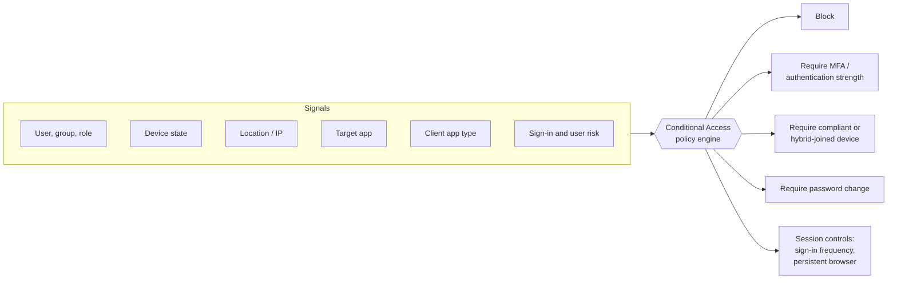
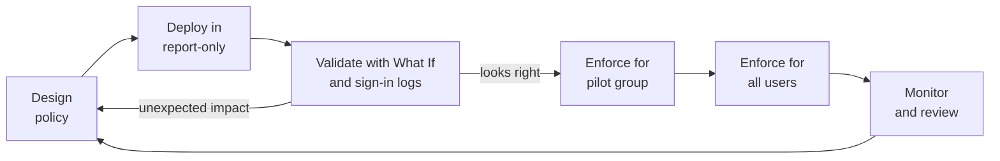

#  Zero Trust Identity : Conditional Access with Microsoft Entra ID


> Build, test and automate a Zero Trust **Conditional Access** baseline in Microsoft Entra ID, from design and report-only validation through enforcement and cleanup. Every policy ships twice: as a documented portal walkthrough and as deployable Microsoft Graph JSON.

## Contents

1. [Overview](#1-overview)
2. [Zero Trust mapping](#2-zero-trust-mapping)
3. [Architecture](#3-architecture)
4. [Policy catalog](#4-policy-catalog)
5. [Prerequisites](#5-prerequisites)
6. [Repository layout](#6-repository-layout)
7. [Quick start (automation)](#7-quick-start-automation)
8. [Walkthrough: how it was built](#8-walkthrough-how-it-was-built)
9. [Test matrix](#9-test-matrix)
10. [Design decisions](#10-design-decisions)
11. [Troubleshooting and gotchas](#11-troubleshooting-and-gotchas)
12. [Cleanup](#12-cleanup)
13. [Where to go next](#13-where-to-go-next)
14. [References](#14-references)

---

## 1. Overview

Zero Trust means no sign-in is trusted just because it comes from the right network or presents a valid password. Conditional Access (CA) is the policy engine in Microsoft Entra ID that turns that idea into enforceable rules: it reads signals about the **user, device, location, application, client type and risk** at sign-in time and decides whether to allow, challenge or block.

This lab builds a realistic, layered baseline of **eight policies** in a test tenant and shows the full lifecycle a real change goes through:

| Stage | What you do |
|---|---|
| **Design** | Map Zero Trust principles to concrete policies and exclusions |
| **Scaffold** | Create break-glass account, groups, test users and a named location |
| **Build** | Configure each policy in the Entra admin center *and* as Graph JSON |
| **Validate** | Deploy in **report-only**, then prove behavior with the What If tool and sign-in logs |
| **Enforce** | Roll out in stages and test the real user experience |
| **Operate** | Export evidence, monitor, and clean up |

**Skills demonstrated:** Conditional Access design, authentication strengths (phishing-resistant MFA), risk-based access (Entra ID Protection), device trust, session controls, emergency-access design, safe rollout practice, and Infrastructure-as-Code with Microsoft Graph and PowerShell.

---

## 2. Zero Trust mapping

| Zero Trust principle | What it means for identity | Controls in this lab |
|---|---|---|
| **Verify explicitly** | Authenticate and authorize on every available signal: identity, location, device, risk | CA002 MFA for everyone · CA004 location · CA005 / CA006 risk · CA007 device state |
| **Use least privilege access** | Give privileged identities the strongest protection and the narrowest scope | CA003 phishing-resistant MFA for admin roles · test admin holds *Helpdesk Administrator*, not Global Admin · CA007 scoped to a pilot group first |
| **Assume breach** | Limit blast radius, shorten attacker dwell time, keep evidence | CA001 blocks legacy auth (no MFA, common password-spray path) · CA006 forces a password change for high-risk users · CA008 short-lived browser sessions · sign-in evidence export |

---

## 3. Architecture

Each sign-in is evaluated against every policy. A matching **Block** always wins; otherwise all grant controls from all matching policies must be satisfied, and session controls are applied on top.



The lab follows the rollout loop Microsoft recommends: nothing is enforced until it has been observed in report-only.



---

## 4. Policy catalog

All lab objects use the `ZTLAB` prefix so they never collide with real policies and can be removed cleanly.

| ID | Policy | Signals evaluated | Control | License |
|---|---|---|---|---|
| [CA001](policies/CA001-block-legacy-authentication.json) | Block legacy authentication | Client app = Exchange ActiveSync / Other clients | Block | P1 |
| [CA002](policies/CA002-require-mfa-all-users.json) | Require MFA for all users | All users, all resources | Require MFA | P1 |
| [CA003](policies/CA003-require-phishing-resistant-mfa-admins.json) | Phishing-resistant MFA for administrators | 12 privileged directory roles | Authentication strength: *Phishing-resistant MFA* | P1 |
| [CA004](policies/CA004-block-untrusted-countries.json) | Block sign-ins outside allowed countries | Location ≠ allowed countries | Block | P1 |
| [CA005](policies/CA005-require-mfa-risky-signins.json) | MFA for medium/high sign-in risk | Sign-in risk | Require MFA + re-auth every time | **P2** |
| [CA006](policies/CA006-require-password-change-high-user-risk.json) | Password change for high user risk | User risk | Require MFA **and** password change | **P2** |
| [CA007](policies/CA007-require-compliant-device-office365.json) | Compliant or hybrid-joined device for Office 365 (pilot) | Pilot group, Office 365 | Require compliant OR hybrid joined | P1 + Intune |
| [CA008](policies/CA008-browser-session-controls.json) | Limit browser session lifetime | Client app = Browser | Sign-in frequency 8 h, no persistent session | P1 |

**Excluded everywhere:** the `ZTLAB-BreakGlass` group (emergency access). See [Design decisions](#10-design-decisions) for the trade-offs.

---

## 5. Prerequisites

> [!WARNING]
> **Use a test tenant only.** Conditional Access can lock every user out, including you. Never run this lab in a production or employer tenant, and never publish screenshots from one.

| Requirement | Detail |
|---|---|
| **Tenant** | A throwaway Microsoft Entra tenant. The Microsoft 365 Developer Program E5 sandbox is now eligibility-gated; the documented alternative is a free Entra tenant (Azure free account) plus a time-limited **Entra ID P1 or P2 trial**. |
| **Licenses** | **P1** for CA001-004, 007, 008. **P2** (or Microsoft 365 E5) for the risk-based policies CA005/CA006. Assign a license to the test users. CA007 also needs a device enrolled in Intune or hybrid joined to test live. |
| **Admin role** | Global Administrator, or a combination of Conditional Access Administrator, User Administrator, Groups Administrator and Privileged Role Administrator |
| **Tooling** | PowerShell **7.2+** and `Microsoft.Graph.Authentication` (`Install-Module Microsoft.Graph.Authentication -Scope CurrentUser`) |
| **Optional** | An Azure subscription with a Log Analytics workspace (for the Insights workbook) · a FIDO2 key or passkey (to satisfy CA003 live) · a VPN (to test the geo-block live) |

---

## 6. Repository layout

```text
.
├── README.md                      <- you are here
├── policies/                      <- Graph JSON, one file per policy (tokenised, validated)
│   ├── CA001-block-legacy-authentication.json
│   ├── CA002-require-mfa-all-users.json
│   ├── CA003-require-phishing-resistant-mfa-admins.json
│   ├── CA004-block-untrusted-countries.json
│   ├── CA005-require-mfa-risky-signins.json
│   ├── CA006-require-password-change-high-user-risk.json
│   ├── CA007-require-compliant-device-office365.json
│   └── CA008-browser-session-controls.json
├── scripts/
│   ├── _common.ps1                <- Graph helpers, tenant guard, state handling
│   ├── 01-Initialize-Lab.ps1      <- groups, users, break-glass, named location
│   ├── 02-Deploy-CAPolicies.ps1   <- create/update policies (ReportOnly | Enabled | Disabled)
│   ├── 03-Export-SignInEvidence.ps1 <- per-policy results from sign-in logs -> CSV
│   ├── 99-Remove-Lab.ps1          <- delete everything the lab created
│   └── Test-Screenshots.ps1       <- pre-publish check for missing/placeholder images
├── screenshots/                   <- figures referenced below + capture guide
├── evidence/                      <- script exports land here (git-ignored)
├── LICENSE
└── .gitignore
```

---

## 7. Quick start (automation)

Prefer code to clicking? This is the whole lab in four commands. The [walkthrough](#8-walkthrough-how-it-was-built) shows the same result through the portal.

```powershell
git clone https://github.com/mraaron360/entra-conditional-access-zero-trust-lab.git
cd entra-conditional-access-zero-trust-lab

# 1. Scaffold: groups, test users, break-glass account, named location
./scripts/01-Initialize-Lab.ps1 -AllowedCountries US -LicenseSkuPartNumber AAD_PREMIUM_P2

# 2. Deploy all policies in REPORT-ONLY (nothing is enforced)
./scripts/02-Deploy-CAPolicies.ps1 -Mode ReportOnly

# 3. After signing in as the test users, review how policies evaluated
./scripts/03-Export-SignInEvidence.ps1 -Hours 6

# 4. Enforce in stages once the results look right
./scripts/02-Deploy-CAPolicies.ps1 -Mode Enabled -Only CA001,CA002
```

Useful switches: `-WhatIf` (dry run), `-SkipRiskPolicies` (no P2), `-SkipDevicePolicy` (no Intune), `-Only CA001,CA004` (subset). Every script asks you to **type the tenant name** before changing anything, and the deploy script refuses to touch any policy that does not start with `ZTLAB`.

> [!NOTE]
> `-LicenseSkuPartNumber` is optional. Common values: `AAD_PREMIUM` (Entra ID P1), `AAD_PREMIUM_P2` (Entra ID P2), `SPE_E5` (Microsoft 365 E5). If the SKU is not found, the script lists the SKUs your tenant actually has.

---

## 8. Walkthrough: how it was built

Portal: <https://entra.microsoft.com>. Screenshot placeholders in `screenshots/` are replaced with real captures before publishing; see the [capture guide](screenshots/README.md).

### Part A. Prepare the tenant

**Step 1: Confirm tenant and licensing.** Open **Overview** and **Billing > Licenses** and confirm an Entra ID P1/P2 (or M365 E5) license is available to assign.


**Step 2: Disable security defaults.** Security defaults and Conditional Access are mutually exclusive. Go to **Entra ID > Overview > Properties > Manage security defaults**, set **Disabled**, and choose *My organization is using Conditional Access*.


> [!NOTE]
> Your tenant may already contain **Microsoft-managed** Conditional Access policies. Leave them alone. They coexist with the `ZTLAB` policies, and any grant or block they apply also applies during your tests.

### Part B. Scaffold the lab

Create these objects in the portal, or run `01-Initialize-Lab.ps1` to create them all.

| Object | Name | Purpose |
|---|---|---|
| Group | `ZTLAB-BreakGlass` | Emergency-access exclusion group |
| Group | `ZTLAB-Pilot-Users` | Scope for the device policy (CA007) |
| User | `ztlab-breakglass01` | Cloud-only emergency access account, member of `ZTLAB-BreakGlass` |
| User | `ztlab-user01` | Standard test user |
| User | `ztlab-pilot01` | Standard user, member of `ZTLAB-Pilot-Users` |
| User | `ztlab-admin01` | Holds **Helpdesk Administrator**, which is in CA003's scope |
| Named location | `ZTLAB-Allowed-Countries` | Country-based location used by CA004 |

**Step 3: Groups.** **Entra ID > Groups > New group**: security groups, assigned membership.


**Step 4: Users.** **Entra ID > Users > New user > Create new user**. Use the `*.onmicrosoft.com` domain, long random passwords, and assign a license to the three test users. Give the emergency account a **passkey (FIDO2)**; see [Design decisions](#10-design-decisions) for why.


**Step 5: Named location.** **Protection > Conditional Access > Named locations > Countries location**. Name it `ZTLAB-Allowed-Countries`, determine location by **IP address**, select your country, and leave *Include unknown countries/regions* **unchecked**.


### Part C. Build the policies (portal)

For every policy: **Protection > Conditional Access > Policies > New policy**, then:

- **Users > Include:** as listed below. **Exclude:** group `ZTLAB-BreakGlass`.
- **Enable policy:** **Report-only**. (Never start with *On*.)

The exact request body for each policy is in [`policies/`](policies/), so you can compare portal settings against JSON.

<details open>
<summary><b>CA001. Block legacy authentication</b></summary>

Legacy protocols (basic auth over SMTP/IMAP/POP, older ActiveSync) cannot perform MFA, which makes them the preferred route for password spray.

- **Users:** All users
- **Target resources:** All resources
- **Conditions > Client apps:** Configure = Yes, tick only **Exchange ActiveSync clients** and **Other clients**
- **Grant:** Block access


</details>

<details open>
<summary><b>CA002. Require MFA for all users</b></summary>

- **Users:** All users
- **Target resources:** All resources
- **Grant:** Grant access > **Require multifactor authentication**


</details>

<details open>
<summary><b>CA003. Phishing-resistant MFA for administrators</b></summary>

Administrator accounts are the highest-value target, and push or SMS MFA can be phished with adversary-in-the-middle kits. Authentication strength lets you demand a specific *kind* of MFA.

- **Users > Include:** Select users and groups > **Directory roles**: Global Administrator, Privileged Role Administrator, Security Administrator, Conditional Access Administrator, Exchange Administrator, SharePoint Administrator, User Administrator, Application Administrator, Cloud Application Administrator, Helpdesk Administrator, Authentication Administrator, Privileged Authentication Administrator
- **Target resources:** All resources
- **Grant:** **Require authentication strength > Phishing-resistant MFA** (passkey/FIDO2, Windows Hello for Business, or certificate-based authentication)

> [!CAUTION]
> An admin with no phishing-resistant method registered cannot satisfy this policy. Keep it **report-only** until `ztlab-admin01` has registered a passkey.


</details>

<details open>
<summary><b>CA004. Block sign-ins from outside allowed countries</b></summary>

- **Users:** All users
- **Target resources:** All resources
- **Conditions > Locations:** Configure = Yes. **Include:** Any network or location. **Exclude:** Selected networks and locations > `ZTLAB-Allowed-Countries`
- **Grant:** Block access


</details>

<details open>
<summary><b>CA005. MFA for medium and high sign-in risk (P2)</b></summary>

- **Users:** All users
- **Target resources:** All resources
- **Conditions > Sign-in risk:** Configure = Yes, **High** and **Medium**
- **Grant:** Require multifactor authentication
- **Session:** Sign-in frequency = **Every time**


</details>

<details open>
<summary><b>CA006. Password change for high user risk (P2)</b></summary>

- **Users:** All users
- **Target resources:** All resources
- **Conditions > User risk:** Configure = Yes, **High**
- **Grant:** tick **Require multifactor authentication** and **Require password change**, then *Require all the selected controls*
- **Session:** Sign-in frequency = **Every time**


</details>

<details open>
<summary><b>CA007. Compliant or hybrid-joined device for Office 365 (pilot)</b></summary>

Device trust is a core Zero Trust signal, and it is also the easiest policy to lock people out with, so it starts on a pilot group.

- **Users > Include:** Select users and groups > Groups > `ZTLAB-Pilot-Users`
- **Target resources:** Select resources > **Office 365**
- **Grant:** **Require device to be marked as compliant** and **Require Microsoft Entra hybrid joined device**, then *Require one of the selected controls*


</details>

<details open>
<summary><b>CA008. Limit browser session lifetime and persistence</b></summary>

- **Users:** All users
- **Target resources:** All resources (persistent browser session only works with *All resources*)
- **Conditions > Client apps:** Configure = Yes, **Browser** only
- **Session:** Sign-in frequency > Periodic reauthentication **8 hours** · Persistent browser session > **Never persistent**


</details>

### Part D. The same thing as code

The JSON files are plain Graph `conditionalAccessPolicy` bodies with a few `{{TOKENS}}` (state, break-glass group, pilot group, named location, directory role names). `02-Deploy-CAPolicies.ps1` resolves the tokens, then creates or updates each policy by name, so it is idempotent.

```powershell
./scripts/02-Deploy-CAPolicies.ps1 -Mode ReportOnly -WhatIf   # preview
./scripts/02-Deploy-CAPolicies.ps1 -Mode ReportOnly           # deploy
```


### Part E. Validate in report-only

Report-only evaluates a policy on every sign-in and logs what *would* have happened, without affecting the user.

**Step 6: Confirm state.** **Conditional Access > Policies** should show every `ZTLAB` policy as **Report-only**.


**Step 7: What If.** **Conditional Access > Policies > What If** evaluates a hypothetical sign-in against all policies, *including report-only ones*, and lists which apply and why others do not.

- *Standard user:* `ztlab-user01`, Exchange Online, an IP in an allowed country, client app **Browser**. Expect CA002 (MFA) and CA008 (session) to apply.


- *Blocked country:* the same user with an IP that geolocates outside your allowed countries. Expect CA004 (**Block**) to apply.


**Step 8: Real sign-ins.** Sign in to `https://myapps.microsoft.com` as `ztlab-user01`, wait a few minutes, then open **Monitoring & health > Sign-in logs**, select the entry, and review the **Conditional Access** and **Report-only** tabs.


Export the same data for the repo with `./scripts/03-Export-SignInEvidence.ps1 -Hours 6`.

**Step 9 (optional): Insights workbook.** **Conditional Access > Insights and reporting** compares report-only and enforced impact over time. It needs sign-in logs streamed to a Log Analytics workspace (**Monitoring & health > Diagnostic settings**).


How to read the **Report-only** results:

| Result | Meaning |
|---|---|
| Success | Policy applied and its controls *would* have been satisfied |
| Failure | Policy applied and *would have blocked* or failed the sign-in |
| User action required | Policy applied and *would have prompted* the user (MFA, password change, ...) |
| Not applied | Conditions did not match (wrong user, app, location, ...) |

### Part F. Enforce in stages, then test

Do not flip everything on at once. Suggested order, lowest to highest lockout risk:

| Wave | Policies | Command | Gate |
|---|---|---|---|
| 1 | CA001, CA002 | `-Mode Enabled -Only CA001,CA002` | No unexpected *Failure* in report-only |
| 2 | CA004 | `-Mode Enabled -Only CA004` | Allowed-country list covers your real users and travel |
| 3 | CA003 | `-Mode Enabled -Only CA003` | Every admin has a phishing-resistant method registered |
| 4 | CA005, CA006 | `-Mode Enabled -Only CA005,CA006` | P2 in place; risk simulated safely (see test matrix) |
| 5 | CA007 | `-Mode Enabled -Only CA007` | Pilot devices are compliant or hybrid joined |
| 6 | CA008 | `-Mode Enabled -Only CA008` | Users accept the prompt cadence |

**Test the user experience.** After CA002 is **On**, a password-only sign-in as `ztlab-user01` triggers an MFA registration/challenge:


After CA004 is **On**, a sign-in from outside the allowed countries is blocked (error `53003`, *Access has been blocked by Conditional Access policies*):


Final state:


---

## 9. Test matrix

Use this as a checklist and record your own results. The *Figure* column shows where the related policy or test appears above.

| # | Scenario | Expected outcome | How to verify | Figure |
|---|---|---|---|---|
| T1 | `ztlab-user01` browser sign-in from an allowed country | CA002 requires MFA; CA008 applies session limits; CA001/CA004 not applied | What If, then sign-in log | Fig. 16, 18 |
| T2 | Legacy client (What If client app = *Exchange ActiveSync* or *Other clients*) | CA001 **Block** | What If. A live test depends on which legacy protocols your tenant still allows. | Fig. 06 |
| T3 | Sign-in from an IP outside allowed countries | CA004 **Block** | What If with a foreign IP; live test via VPN | Fig. 17, 21 |
| T4 | `ztlab-admin01` (Helpdesk Administrator) signs in | CA003 requires phishing-resistant MFA | What If; live only after registering a passkey | Fig. 08 |
| T5 | `ztlab-pilot01` opens Office 365 from an unmanaged device | CA007 requires compliant or hybrid-joined device | Sign-in log (needs a real device to pass) | Fig. 12 |
| T6 | Medium/high sign-in risk | CA005 requires MFA with re-auth every time | What If with *Sign-in risk = Medium*. Live: simulate an anonymous-IP detection with Tor Browser using a test account not yet registered for MFA. | Fig. 10 |
| T7 | High user risk | CA006 requires MFA **and** password change | What If with *User risk = High* | Fig. 11 |
| T8 | `ztlab-breakglass01` sign-in | **No** `ZTLAB` policy applies (excluded) | What If for the break-glass user (optional extra capture) | n/a |

---

## 10. Design decisions

- **Report-only first, always.** It is the only safe way to learn what a policy will do to real traffic. Policies are *deployed* in report-only by default; enforcing is a deliberate second step.
- **Groups, not named users.** Targeting groups keeps policies stable while membership changes. The break-glass exclusion is one group reused everywhere.
- **Break-glass accounts are excluded, but not unprotected.** Excluding them from CA prevents a policy mistake from locking everyone out. They still fall under Microsoft's mandatory-MFA enforcement for admin portals, so a password-only emergency account will not work. Register a **passkey (FIDO2)** on it, store the credentials offline, and alert on *any* sign-in. This lab creates one account for simplicity; Microsoft's guidance is **two or more**.
- **Phishing-resistant MFA for privileged roles only.** It is the strongest control but needs hardware or platform authenticators, so it is scoped to admins first (least privilege) rather than the whole workforce.
- **Geo-blocking is a coarse filter, not a security boundary.** VPNs and proxies defeat it. It removes a large class of opportunistic traffic cheaply, and works best layered with MFA and risk policies.
- **Device policy starts with a pilot group.** Compliance and join state have the most moving parts (enrollment, sync lag, unsupported platforms).
- **Session controls are tuned, not maximized.** CA008 shows the mechanism. Very short sign-in frequencies cause MFA fatigue, which is its own risk; tune to your threat model.
- **Everything is code.** Policies as reviewable JSON, applied by an idempotent script, means changes can go through pull requests and drift is detectable.

---

## 11. Troubleshooting and gotchas

<details>
<summary><b>Click to expand</b></summary>

- **"I can't create policies / policies don't apply."** Security defaults must be disabled first (Step 2).
- **Locked out.** Sign in with the break-glass account and set the offending policy to **Off**. This is exactly what that account is for.
- **Conditional Access is not a perimeter.** Policies are enforced *after* first-factor authentication. They do not stop password spraying; they limit what a correct password can do.
- **Sign-in logs are delayed.** Allow a few minutes (longer for the Log Analytics workbook) before concluding a policy "did nothing".
- **Block always wins; grants are ANDed across policies.** If two matching policies require different controls, the user must satisfy both. `OR` applies only *within* a single policy's grant controls.
- **Report-only + device compliance can still prompt.** Policies in report-only that require a compliant device can show macOS, iOS and Android users a device-certificate prompt even though compliance is not enforced. Exclude those platforms from report-only device policies if it bothers testers.
- **Report-only does not cover everything.** Policies scoped to *user actions* cannot be evaluated in report-only.
- **Risk policies need P2 (and a licensed user).** Without it CA005/CA006 will not deploy or will never match. Use `-SkipRiskPolicies`.
- **Authentication strength and the Graph API.** When creating a policy via Graph, send only `authenticationStrength.id`. Do not copy the whole object (including `@odata.context` and `combinationConfigurations`) from a GET response, or the request is rejected as malformed.
- **Workload identities are out of scope.** These policies target users. Service principals and managed identities need separate workload-identity policies.
- **Hybrid environments.** Add exclusions for directory-synchronization accounts if you reuse these policies where Entra Connect is in play.

</details>

---

## 12. Cleanup

```powershell
./scripts/99-Remove-Lab.ps1 -WhatIf    # preview what will be deleted
./scripts/99-Remove-Lab.ps1            # delete policies, location, users, groups
```

Order matters (policies, then named location, users, groups), and the script only touches objects named `ZTLAB...` / `ztlab-...`. Deleted users stay in the Entra recycle bin for 30 days. If you created Azure resources for the workbook, delete that resource group too.

---

## 13. Where to go next

- **Privileged Identity Management (PIM):** make admin roles eligible and time-bound instead of permanent, and pair with CA003.
- **Continuous Access Evaluation and token protection:** cut the window in which a stolen token is useful.
- **Authentication contexts:** step-up authentication for specific sensitive actions or SharePoint sites.
- **Custom authentication strengths:** tailor allowed method combinations per audience.
- **Conditional Access as code in CI:** run `02-Deploy-CAPolicies.ps1 -Mode ReportOnly` from GitHub Actions using workload identity federation, and open a PR for every change.
- **Monitoring:** alert on break-glass sign-ins and on CA policy changes in the audit log.
- **Global Secure Access:** require a compliant network as an additional signal.

---

## 14. References

- [Conditional Access overview](https://learn.microsoft.com/entra/identity/conditional-access/overview)
- [Plan a Conditional Access deployment](https://learn.microsoft.com/entra/identity/conditional-access/plan-conditional-access)
- [Conditional Access report-only mode](https://learn.microsoft.com/entra/identity/conditional-access/concept-conditional-access-report-only)
- [Troubleshoot with the What If tool](https://learn.microsoft.com/entra/identity/conditional-access/troubleshoot-conditional-access-what-if)
- [Conditional Access insights and reporting](https://learn.microsoft.com/entra/identity/conditional-access/howto-conditional-access-insights-reporting)
- [Authentication strengths (Graph)](https://learn.microsoft.com/graph/api/resources/authenticationstrengths-overview)
- [signInFrequencySessionControl (Graph)](https://learn.microsoft.com/en-us/graph/api/resources/signInFrequencySessionControl)
- [Create a Conditional Access policy with Microsoft Graph PowerShell](https://learn.microsoft.com/powershell/module/microsoft.graph.identity.signins/new-mgidentityconditionalaccesspolicy)
- [Manage emergency access accounts](https://learn.microsoft.com/entra/identity/role-based-access-control/security-emergency-access)
- [Simulate risk detections in ID Protection](https://learn.microsoft.com/entra/id-protection/howto-identity-protection-simulate-risk)
- [Microsoft 365 Developer Program](https://learn.microsoft.com/office/developer-program/microsoft-365-developer-program)
- [Zero Trust overview](https://learn.microsoft.com/security/zero-trust/zero-trust-overview)

---

## Author

Built by **Aaron** · Identity & Access Management · Microsoft Entra ID · SC-300 · SC-500
GitHub: [@mraaron360](https://github.com/mraaron360)

Released under the [MIT License](LICENSE). Provided for learning; test in a non-production tenant and review every policy before enforcing it.
